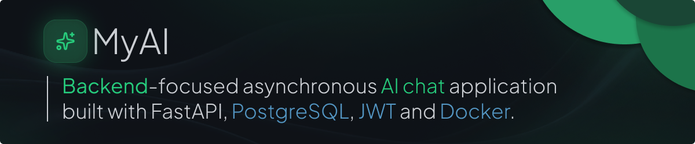
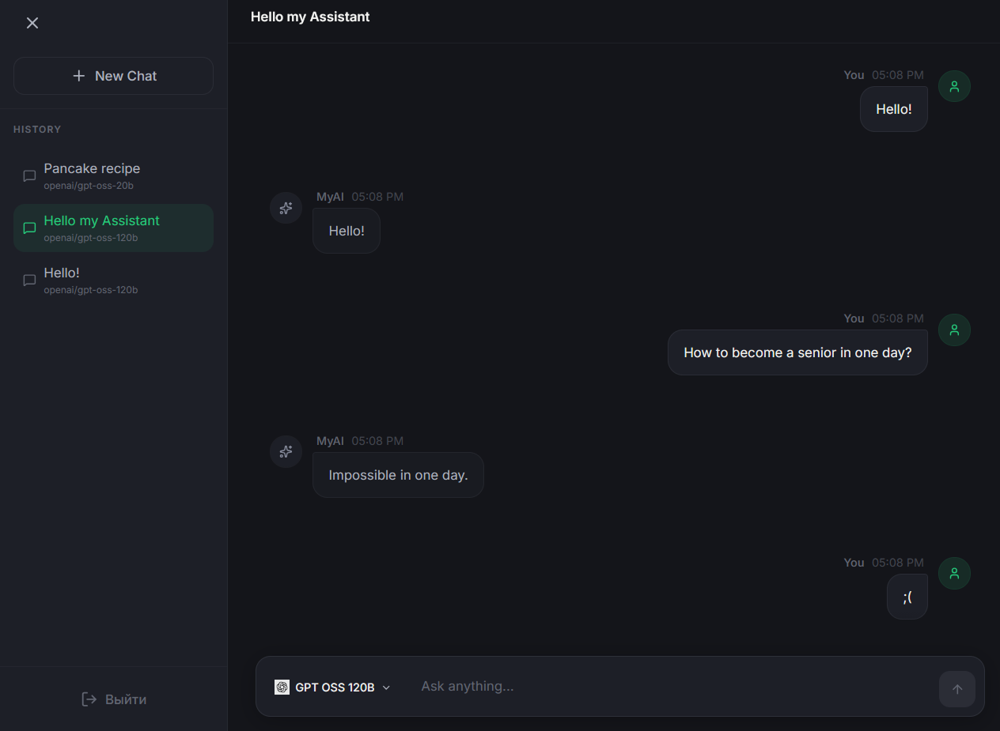
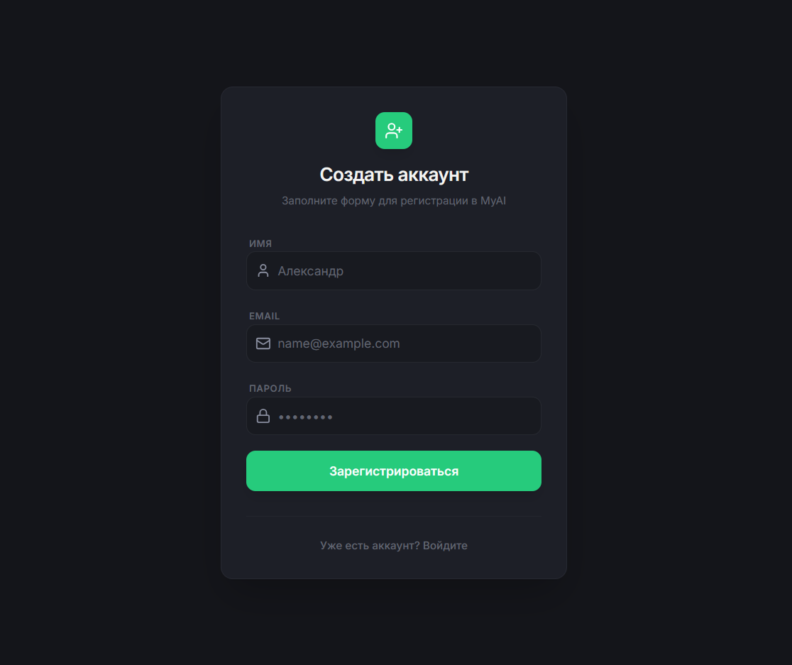

# MyAI

> Асинхронный backend чат-приложения с AI-моделями: FastAPI, PostgreSQL, SQLAlchemy 2.x Async ORM, JWT-аутентификация с ротацией refresh-токенов и cursor-based pagination истории диалогов.

<p align="center">
  
</p>

<p align="center">
  
  
  
  
  
</p>

<p align="center">
  <a href="#возможности">Возможности</a> ·
  <a href="#архитектура">Архитектура</a> ·
  <a href="#api">API</a> ·
  <a href="#быстрый-запуск">Быстрый запуск</a>
</p>

## О проекте

MyAI — чат-платформа для взаимодействия с AI-моделями.

Проект демонстрирует практическое применение асинхронного Python-стека: слоистой архитектуры, JWT-аутентификации, cursor-based pagination, работы с PostgreSQL через SQLAlchemy Async ORM и интеграции с внешним AI-провайдером через OpenAI-совместимый API.

В репозитории также есть React/TypeScript-клиент для демонстрации взаимодействия backend- и frontend-частей и проверки API-интеграции.

## Скриншоты

### AI-чат

<p align="center">
  
</p>

### Авторизация

<p align="center">
  
</p>

## Возможности

### Аутентификация и безопасность

- Регистрация и авторизация с JWT access- и refresh-токенами через AuthX.
- Ротация refresh-токена при каждом запросе к `/refresh`: создаётся новый `jti`, а прежняя запись становится недействительной.
- В базе данных хранится только SHA-256-хеш refresh-токена, а не сам токен.
- Пароли хешируются с помощью Argon2.
- CPU-затратные операции хеширования выносятся в отдельный поток через `asyncio.to_thread`, чтобы не блокировать event loop.
- Проверка прав доступа к чату выполняется на каждом запросе.
- Обращение к чужому чату возвращает статус `404` без раскрытия факта существования ресурса.

### AI-чат

- Каталог AI-моделей хранится в базе данных и заполняется идемпотентно при старте приложения.
- AI-провайдер можно заменить через конфигурацию; текущий провайдер — Groq.
- Сообщение пользователя сохраняется до обращения к AI-провайдеру.
- При сбое внешнего провайдера API возвращает `502`, а сохранённое сообщение не теряется.
- В контекст AI-модели передаются последние сообщения текущего диалога.
- Поддерживается выбор модели из каталога доступных моделей.

### История и пагинация

- Cursor-based keyset пагинация с использованием параметров `before` и `limit`.
- Сортировка выполняется по `(created_at DESC, id DESC)`.
- `id` используется для записей сущностей с одинаковым временем создания.
- Реализовано каскадное удаление чата вместе со связанными сообщениями.
- UUIDv7 используется для идентификаторов основных сущностей.

### Инфраструктура

- Запуск базы данных, API и frontend одной командой:

  ```bash
  docker compose up --build
  ```

- В Docker Compose используются три сервиса: `db`, `api` и `frontend`.
- API запускается только после проверки готовности PostgreSQL.

## Архитектура

Проект построен по слоистой архитектуре:

- API-слой содержит роутеры, подключает зависимости FastAPI, проверяет авторизацию и формирует HTTP-ответы.
- Сервисный слой содержит изолированную бизнес-логику и не зависит от HTTP-слоя.
- Слой базы данных отвечает за ORM-модели, подключение и работу с PostgreSQL.
- Pydantic-схемы используются для валидации входных данных и сериализации ответов.

```text
app/
├── api/v1/          # роуты, HTTP-статусы и маппинг ошибок
├── services/        # бизнес-логика, не зависит от HTTP-слоя
├── db/              # ORM-модели, engine, сессии и Base
├── schemas/         # Pydantic-схемы запросов и ответов
├── scripts/         # seed-скрипты и служебные операции
├── config.py        # конфигурация приложения
└── main.py          # сборка приложения и lifespan
```

### Ключевые решения

- Все роутеры собираются в единый `APIRouter(prefix="/v1")` с тегами для группировки в Swagger.
- Dependency Injection используется для передачи DB-сессии и проверки access-токена.
- `lifespan` выполняет инициализацию приложения и идемпотентное заполнение каталога моделей.
- `lazy="raise"` предотвращает неявную загрузку ORM-связей.
- Связанные данные загружаются явно через `joinedload`.
- Доменные исключения (`ChatAccessError`, `AuthInvalidError`, `PasswordValidationError`) преобразуются в `HTTPException` только на границе API-слоя.

## Технологии

### Backend

| Область | Технологии |
|---|---|
| Язык и runtime | Python 3.12, async I/O |
| Web/API | FastAPI, Uvicorn, ASGI |
| Документация API | OpenAPI, Swagger UI, ReDoc |
| База данных | PostgreSQL 15 |
| ORM | SQLAlchemy 2.x Async ORM |
| Работа с сессиями | `AsyncSession`, `async_sessionmaker` |
| Декларативные модели | `DeclarativeBase`, `Mapped`, `mapped_column` |
| Драйвер PostgreSQL | asyncpg |
| Валидация и конфигурация | Pydantic v2, pydantic-settings, `EmailStr` |
| Аутентификация | AuthX, JWT access/refresh, PyJWT |
| Хеширование паролей | argon2-cffi |
| AI-интеграция | `AsyncOpenAI`, OpenAI-compatible API Groq |
| Идентификаторы | UUIDv7 через `uuid_utils` |

### Frontend и инфраструктура

| Область | Технологии |
|---|---|
| Frontend | React, TypeScript, Vite, TailwindCSS, Axios |
| Web-сервер frontend | Nginx |
| Reverse proxy | `/v1/` → `api:8000` |
| SPA-маршрутизация | Nginx SPA fallback |
| Контейнеризация | Docker, Docker Compose |
| Образ базы данных | `postgres:15-alpine` |
| Проверка готовности БД | `pg_isready` |

## API

Все маршруты имеют префикс `/v1`.

| Метод | Путь | Код | Назначение |
|---|---|---:|---|
| `POST` | `/v1/register/` | `201` | Регистрация и выдача пары токенов |
| `POST` | `/v1/auth/` | `200` | Авторизация пользователя |
| `POST` | `/v1/auth/refresh` | `200` | Обновление и ротация refresh-токена |
| `POST` | `/v1/` | `201` | Отправка сообщения и получение ответа AI |
| `GET` | `/v1/search/sessions` | `200` | История сессий пользователя с cursor-пагинацией |
| `GET` | `/v1/search/{chat_id}` | `200` | Сообщения чата с cursor-пагинацией |
| `DELETE` | `/v1/search/{chat_id}` | `204` | Удаление чата вместе с сообщениями |
| `GET` | `/v1/models/` | `200` | Каталог доступных AI-моделей |

Защищённые endpoints требуют заголовок:

```http
Authorization: Bearer <access_token>
```

## Модель данных

```text
users
├── id UUIDv7 PK
├── email UNIQUE
├── hashed_password
└── name

refresh_tokens
├── id UUIDv7 PK
├── jti
├── user_id FK → users ON DELETE CASCADE
├── token_hash
└── expires_at

chats
├── id UUIDv7 PK
├── user_id FK → users ON DELETE CASCADE
├── title
├── model_name
├── created_at
└── updated_at

messages
├── id UUIDv7 PK
├── chat_id FK → chats ON DELETE CASCADE
├── role
├── content
├── model_name
└── created_at

models
├── id Identity PK
├── provider
├── work_name
├── name
└── icon_key
```

UUIDv7 выбран вместо случайного UUIDv4. Такой идентификатор сохраняет глобальную уникальность и может быть более благоприятен для индексов при вставках благодаря упорядоченности по времени.

## Быстрый запуск

### Требования

- Docker
- Docker Compose
- Git

### Запуск

```bash
git clone https://github.com/Kol1brii/MyAI.git
cd MyAI
cp .env-example .env
docker compose up --build
```
Перед запуском заполните `.env`, включая ключ AI-провайдера.


#### Внимание! 
Провайдер groq.com может не работать из-за региональных ограничений, в случае ответа `HTTP 403 Forbidden ` используйте VPN.

После запуска:

- Frontend: `http://localhost:3000`
- Swagger UI: `http://localhost:8000/docs`
- ReDoc: `http://localhost:8000/redoc`

### Остановка

Остановить контейнеры:

```bash
docker compose down
```

Остановить контейнеры и удалить volume базы данных:

```bash
docker compose down -v
```

## Конфигурация

Скопируйте файл-шаблон:

```bash
cp .env-example .env
```

Заполните необходимые переменные:

| Переменная | Назначение |
|---|---|
| `DATABASE_URL` | Строка подключения к PostgreSQL, например `postgresql+asyncpg://...` |
| `SECRET_KEY` | Секрет для подписи JWT |
| `AI_API_KEY` | API-ключ AI-провайдера |
| `AI_BASE_URL` | OpenAI-совместимый endpoint провайдера |

## Статус проекта

Проект завершён как портфолио-реализация backend чат-приложения.

Он демонстрирует:

- проектирование REST API;
- асинхронный Python и SQLAlchemy Async ORM;
- работу с PostgreSQL;
- JWT-аутентификацию и хранение токенов;
- cursor-based pagination;
- интеграцию с внешним API;
- контейнеризацию и воспроизводимое локальное окружение.

Основной фокус проекта — слоистая архитектура, безопасная работа с токенами,
асинхронная работа с PostgreSQL и воспроизводимое окружение через Docker Compose.

## Лицензия

Проект распространяется под лицензией MIT.